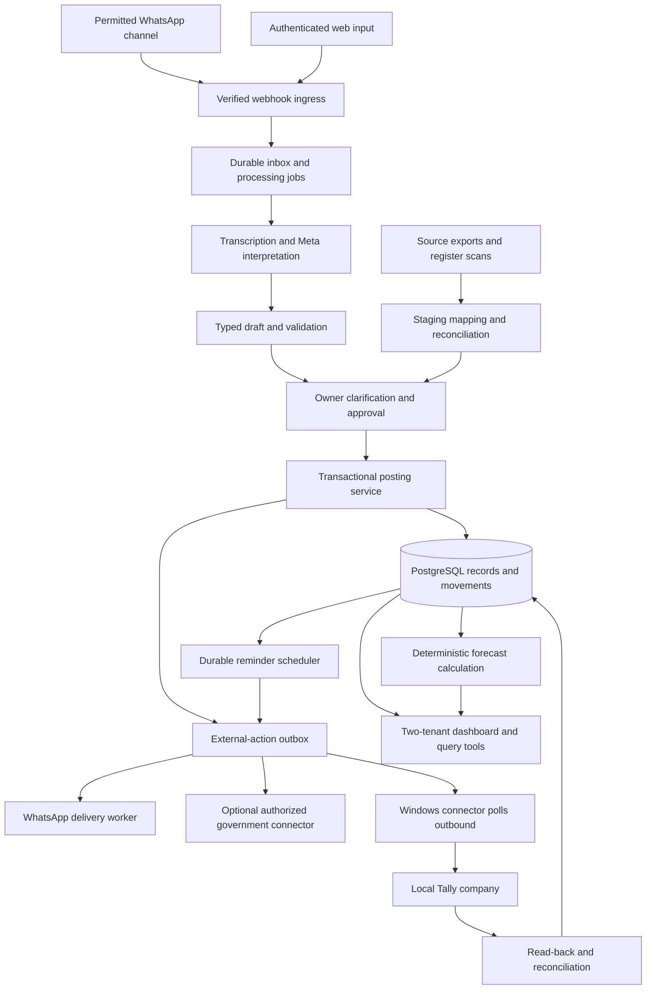
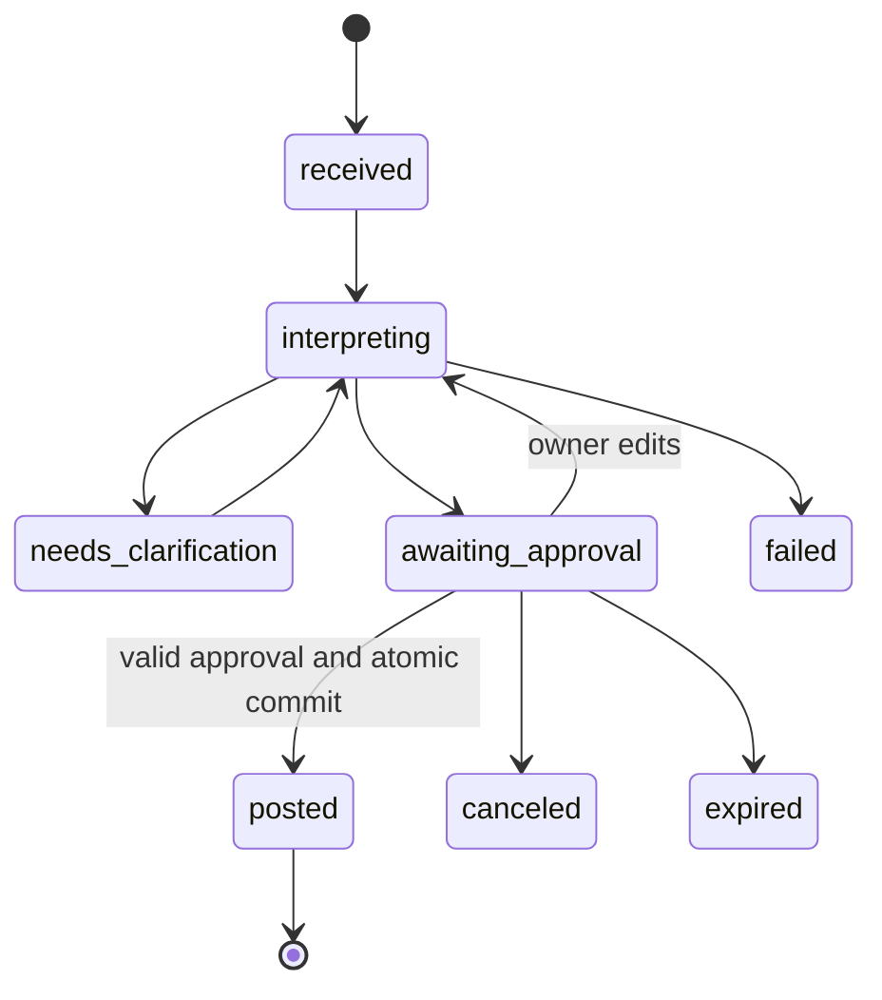

# RFC-001 — Verified business records from voice and documents

Version: 1.3 · Date: 31 October 2026 · Status: proposed

Companion: [Product requirements](PRD.md). This RFC defines a buildable hackathon design; it is not an implementation report. Assumptions and access-dependent features are explicit.

## 1. Decision summary

Use a modular Java + Spring Boot application, PostgreSQL/Supabase for records and durable jobs, private object storage for evidence, a small server-rendered review dashboard, and an optional outbound-polling Windows connector for Tally. The application database is the post-cutover operational source of truth for two isolated businesses, including multiple godowns, accounting subledgers, reminders and forecasts.

Use one Meta reasoning/vision model with typed tools and bounded orchestration. Add speech transcription for voice notes. Worker roles are application modules, not independent autonomous agents with separate memories. Do not introduce a multi-agent framework, vector database, message broker, generic plugin marketplace, or a separate frontend build. Any pre-event code reuse must first be checked against the Indie-track rules; simpler reuse is not automatically eligible.

Models propose changes; application code validates and calculates; the owner approves; a database transaction commits local effects; independent jobs carry out external actions. Unknown external outcomes are reconciled, never blindly retried.

## 2. Constraints and assumptions

- Market: Agra MSMEs; primary demonstration is a plastic-bag wholesaler. The earlier surgical shop is not the demo.
- Two business tenants in one deployment, each with multiple named godowns/locations, INR, Asia/Kolkata dates and authorized memberships. Second live business to be confirmed; use a labeled second fixture until then.
- Owners may belong to both businesses. Active-business context is explicit; messages/approvals/jobs retain their original tenant even after switching.
- The assistant owns operational records after an approved cutover. Tally and other source systems can provide selected-year history through a one-time staged import; continuous two-way sync is not required.
- Historical import supports a documented export shape first, with mappings and rejected rows. A generic import pipeline does not mean arbitrary raw files can be interpreted perfectly.
- Existing Tally connector is optional pre-event work. Core workflows run without it. Do not reuse it in the Indie submission without clarifying eligibility; never present it as event-built functionality.
- E-way generation is an optional government connector; provider credentials and official result lookup are needed only if enabled.
- Real scheduled owner/customer messaging and demand forecasting are MVP capabilities. Consent/templates and reliable history are prerequisites to their respective outcomes, not grounds for claiming them complete without evidence.
- No migration of the owner's current WhatsApp number or automatic access to old chat history is assumed.
- The bot processes only supplied data and authenticated events. It cannot infer missing stock, sales, payment settlement, or hidden physical counts.

## 3. Technology choices

| Layer | Proposed choice | Reason / boundary |
|---|---|---|
| API and domain logic | Java + Spring Boot MVC; Java records, Jackson and Jakarta Bean Validation | Familiar stack; typed model/tool contracts with explicit domain validation |
| Database | Supabase PostgreSQL, Spring Data JPA, Flyway SQL migrations | Explicit transactions, constraints, row locking and durable jobs; native SQL where needed |
| Authentication | Supabase Auth with Spring Security token validation and protected web sessions; verified channel identity for WhatsApp | Server resolves business membership; client cannot select arbitrary tenant |
| Evidence | Private Supabase Storage | Controlled short-lived document access |
| Dashboard | Thymeleaf + Bootstrap + modest JavaScript/CSS, same application | Server-rendered operational workspace; no separate frontend build |
| AI | Meta vision/reasoning and transcription endpoints through Spring RestClient | Direct HTTP integration, bounded extraction and validated tool proposals |
| Jobs | PostgreSQL jobs/outbox + Spring worker; @Scheduled wakes the poller | Persistent schedules, leases and outcomes; no in-memory-only reminders or message broker |
| Invoice artifact | Apache PDFBox with deterministic layout/calculations and embedded fonts | Verify Hindi font rendering; PDF generation is separate from statutory submission |
| Optional Tally bridge | Outbound-polling process on authorized Windows PC; SQLite receipt journal | New bridge may use Java; any pre-existing Python connector stays isolated and requires eligibility review; no core dependency |
| Testing | JUnit, Spring Boot Test and PostgreSQL integration tests via Testcontainers | Verify stock, ledger, atomicity, duplicate events, jobs and tenant isolation against PostgreSQL |
| Build/deployment | Maven Wrapper, executable Spring Boot JAR, one Docker image, managed DB/storage | Start with API and background worker in one application; no Kubernetes |

These are proposed dependencies, not an installed environment. Pin a supported JDK and compatible Spring Boot release when implementation starts; commit the Maven Wrapper and pom.xml with controlled dependency versions. Prefer the supported release Ashish knows over an unnecessary framework migration. An existing stack may inform design choices, but reuse of pre-event code requires the eligibility check described in the rules review.

### Java implementation boundaries

- Keep ingestion, interpretation, inventory, ledger, imports, forecasting and reminders as modules in one application. Do not build microservices or a generic agent framework.
- RestClient calls Meta with explicit timeouts and bounded retries for safe operations. Deserialize into Java records and validate schema, tenant scope and domain rules; model JSON never directly becomes a posted JPA entity. Keep provider calls outside database transactions.
- Use public transactional service boundaries for atomic postings; avoid Spring proxy self-invocation bypassing `@Transactional`. Lock affected stock rows in stable order and enforce database uniqueness/idempotency. Use short native SQL transactions for job claims when needed. Flyway owns schema changes; Hibernate validates rather than auto-updates the production schema.
- Represent money as integer paise (`long` with overflow checks) and quantities/fractional unit prices as `BigDecimal`, with explicit rounding. Never use `double` for stock or money. Implement forecast baselines and evaluation in Java; no Python runtime is needed for core workflows.
- `@Scheduled` only wakes the job poller. PostgreSQL stores due times, approvals, leases, attempts and provider outcomes. Claim jobs atomically, recover expired leases, and reconcile uncertain sends before retrying. Multiple instances must not claim the same live lease.
- Use Spring Security to verify Supabase identity (signature, issuer, audience and expiry), resolve memberships server-side, and protect cookie-authenticated mutations with CSRF. Database connections do not automatically inherit a user's Supabase identity; explicitly scope backend queries and test tenant isolation.
- Start with API and worker in one process, using bounded background execution so inference does not block webhook acknowledgement. A separate worker profile using the same JAR is optional only if deployment needs it; persistence and correctness must not depend on that split.

### Model selection spike

Current Meta documentation lists `muse-spark-1.3` for multimodal reasoning and structured output, and `muse-voice-transcribe-1.0` for audio transcription. Treat these as initial candidates, verify access against the credited account, and record actual model IDs in evaluation runs. [T1]

Structured JSON is a transport format, not proof of factual correctness. Test handwritten bills, packaging, code-switching, numbers, and unit phrases before selecting the primary model. If dedicated transcription fails on the owner's speech, compare available Meta audio understanding and a disclosed alternate transcription provider; do not silently change providers or assume credits cover it. The participant guide requires Meta models and does not expressly settle mixed-provider eligibility; verify any proposed fallback before relying on it in the submission. No model training is required.

## 4. Architecture



The webhook request never waits for the model, Tally, or a government API. It verifies, durably stores, schedules, and acknowledges. If durable persistence fails, return a retryable failure rather than acknowledging lost work.

## 5. Domain boundaries and invariants

### Core modules

1. Ingestion: authentication, media intake, deduplication, evidence.
2. Interpretation: transcript, extraction, candidate product/party matching, intent.
3. Draft/review: required-field checks, versioning, owner confirmation.
4. Posting: deterministic monetary calculations, stock and receivable mutations.
5. Queries: bounded read-only report functions.
6. Locations: container facts, same-business transfers, last-confirmed location and ownership.
7. Historical onboarding: staged import, source mappings, reconciliation and cutover snapshots.
8. Tasks: due scheduling, consent/freshness checks, delivery tracking and cancellation.
9. Forecasting: history quality, bounded numeric baselines, evaluation and explanations.
10. Integrations: required messaging/document rendering, optional Tally and government connectors.

### Invariants

- A model cannot directly write a posted record or call arbitrary SQL, HTTP URLs, shell commands, or Tally XML.
- Every mutation has business, actor, source, effective time, approval, and stable operation ID.
- The same approved operation posts local effects at most once, enforced by a unique key.
- Quantities are decimals in a confirmed base unit. Binary floating point is prohibited for money and quantity conversion.
- Money uses integer paise; unit prices needing finer precision use fixed-decimal input and are rounded only by the configured calculation rule.
- Posted records are immutable. Corrections are linked reversals, adjustments, or credit records.
- An invoice does not by itself prove receipt or dispatch of goods. Separate stock effects require explicit confirmation.
- Local posting and external success are distinct facts.
- A location fact is not a purchase; a stock-only receipt/dispatch is not an invoice; a reminder is not automatically a second debt.
- A godown transfer preserves total business-owned quantity and creates no revenue or expense.
- Historical rows cannot affect current balances twice; approved cutover snapshots seed live balances exactly once.
- A scheduled job uses its stored business/recipient/payload, never the sender's current chat context.
- Forecasts are computed from eligible numeric history, not invented by a language model.
- Human/operator actions are attributed; no invisible manual correction is presented as AI output.
- Unknown data is stored as null/unknown, never zero, an invented date, or a guessed tax rate.

## 6. Data model

All business-owned tables carry `business_id`. IDs are UUIDs. Internal timestamps are UTC; business date and user-specified occurrence time are stored separately. User-visible dates use Asia/Kolkata. Foreign keys crossing business entities must include/check the tenant, not just the UUID.

| Table | Key fields and constraints |
|---|---|
| businesses | id, name, timezone, currency, count_cutoff, configured invoice series, verified business/tax profile, channel eligibility state |
| memberships | business_id, auth_user_id, role; unique membership |
| channel_identities / channel_contexts | verified sender identity and memberships; active business with context version, selected_at; reply IDs preserve original tenant |
| locations | business_id, code/name, parent shelf/bin optional, active; unique business/code |
| containers / location_facts | business_id, label, optional product/lot, party relation with explicit role, ownership (business/customer/unknown), confirmed location, updated_at, evidence; quantity nullable |
| container_location_events | container_id, from/to location, effective time, actor, evidence; append-only history |
| evidence | id, business_id, message_id, private object key, content hash, MIME, extraction/transcript, received_at, retention state |
| inbound_messages | provider event/message ID, business_id, source reference, reply-to, received_at, processing state; unique provider/channel/message ID |
| products | id, business_id, SKU, name, brand, variant, base_unit, active, tax configuration status; unique business/SKU |
| product_aliases | business_id, product_id, normalized alias, supplier context; approved mappings only |
| product_units | product_id, unit label, decimal factor_to_base, approved_by; conversion frozen on every transaction line |
| batches | business_id, product_id, batch label, expiry/date precision or unknown; only create when batch information matters |
| count_sessions / count_lines | location/shelf, effective_at, scope, proposed count, confirmed count, baseline stock version, count evidence; unique session/product/batch |
| parties | customer/supplier/both, display name, optional verified GSTIN/contact, contact consent; names need not be unique |
| drafts | kind, payload JSON, missing_fields, validation errors, version, content hash, status, expires_at, source IDs |
| approvals | draft_id, draft_version, payload_hash, actor, action, approved_at; unique final posting approval per version |
| documents / document_lines | posted invoice/purchase/credit/receipt/opening-credit record, party, document number/date, totals, lines, original link, approved operation ID |
| stock_movements | product/batch/location, optional container, ownership, signed base quantity, reason, source document/count, occurrence time, transfer/group ID, operation ID; immutable unique effect key |
| stock_balances | business/product/batch/location/ownership, quantity, version; updated with movement; uniqueness handles null batch explicitly |
| party_ledger_entries | party, account_side (receivable/payable), signed paise amount, reason, source, effective_at, operation ID; positive increases that side, negative settles/credits it; never net the two sides implicitly |
| allocations | receipt/payment/credit entry, target invoice/debt, account_side, amount; cannot exceed source available amount or target outstanding |
| external_jobs | type, immutable approved payload/hash, business, environment, status, attempts, lease, next_attempt_at, external reference, last error, idempotency key |
| external_links | local document, provider, company, external ID and fingerprint, last_verified_at |
| reminder_intents | business, owner-reminder/customer-send, target party/contact, invoice/debt reference optional, note-only flag, approved payload/version, scheduled_at UTC, timezone, local date/time, schedule version, cancellation, delivery reference, dedupe key |
| imports / import_rows | business, source system/company, date range, file hash, source ID/version or row fingerprint, raw/normalized payload, class, status/errors, mapping version, approval, cutoff |
| source_mappings | business/source company/external ID → canonical product/party/unit/location; unique mapping; reviewed conflicts |
| historical_events | approved pre-cutover item sales/returns/purchases/payments with source IDs, occurrence dates, coverage and financial/stock effect = false |
| cutover_snapshots | business, cutoff, scope, source totals, approved quantity/AR/AP lines, linked opening operation, reconciliation and physical-count differences |
| data_coverage | business/product/date range, sales capture state (complete/partial/unknown), stockout flags/source; missing is not zero |
| forecasts | business/product/horizon, generated_at, history cutoff/hash, model-method version, eligibility, predicted quantities, MAE/WAPE where defined, limitations, inputs used |
| audit_events | actor, business, action, entity, before/after references, timestamp, correlation ID; restricted append-only access |
| model_runs | source/draft IDs, model and prompt version, latency, usage, outcome, redacted error; no secrets |

JSON draft payloads allow different draft types without a table per intermediate extraction field. Posted domain records retain typed fields and constraints. Conversation history is context, not the financial database. Avoid embeddings initially: exact IDs, approved aliases, and a bounded text search over the shop catalog suffice.

### Historical imports, opening balances and cutover

MVP migration mode is **historical evidence + reconciled opening snapshot**, not automatic replay into current balances.

1. Select business, source system/company, exact date range (calendar or financial year explicitly), and cutover timestamp. Do not interpret “this year” silently.
2. Upload a documented CSV/JSON/XML export or scans of register pages. Parse supported exports deterministically; scans require extraction and line-by-line review. Do not promise every export format at launch.
3. Preserve originals, create staged rows, detect duplicates and map product/party/unit/location IDs. Require source IDs when available; fallback fingerprint is file hash + row index/content hash, with cross-file overlap flagged for review rather than assumed safe.
4. Present row counts by class, date coverage, unmapped values, debit/credit/stock totals, error rows and source control totals. Missing invoice allocations or item quantities stay missing.
5. Owner resolves mappings and accepts reconciled snapshots: current physical stock per godown and receivable/payable balances with outstanding-document allocations where available. Imported historical balances remain evidence, not a second live opening entry.
6. Activate a versioned import after approval. Store pre-cutover transactions as immutable historical events for search/reports/forecasts, with no live posting effects. Post the approved opening quantities/AR/AP once through the normal posting service.
7. Post-cutover activity uses the application. An import cutoff can differ from export file creation time; use transaction effective dates and IDs, not file dates, to detect overlaps.

For a shop with no usable export, opening quantities come from counted stock and opening debts from explicit owner confirmation. Use a scoped count window or reconcile movements occurring during counting. Unknown location goes into an explicit unassigned bucket; it cannot be reported as physically known. Unknown costs prevent complete valuation/profit claims.

If only past-year transactions are available without trustworthy balances at the current cutoff, retain them for historical analysis and obtain current counts/party balances separately. Do not extrapolate present stock from incomplete history.

Reimports with identical source IDs/hash are no-ops. Changed source versions or overlaps create staged differences. Late imports cannot silently change posted live records or trigger reminders. Apply approved corrections as linked adjustments. Import batches have an activation state; partially processed batches remain invisible to live reports. Activation and opening-effect creation must be idempotent and atomic, or use a final atomic activation pointer for larger staged batches.

A failed staging job is restartable without live effects. To reverse an activated import, prohibit destructive rollback once dependent live activity exists: create reviewed compensating adjustments and supersede historical rows while preserving their audit trail. Never delete evidence behind posted entries.

### Multi-business identity

Resolve sender → authorized memberships → explicit active business. If membership is unique, select it visibly. If multiple, ask/select before an unbound command. Bind every new draft to that business and context version. Replies to earlier confirmation messages resolve their original draft tenant; show that tenant again before approval if the active context differs. Scheduled jobs never read session context. Dashboard queries enforce membership and tenant filters independently of the visible selector.

## 7. Units, money, and transaction semantics

### Product identity

Match in this order: exact known SKU/barcode → approved business/supplier alias → candidate search → model proposes among candidates → owner selects. Do not merge merely similar labels. Different bag dimensions, material/grade, thickness, brand, weight units, and pack sizes remain distinct where applicable. Barcode matches are checked against visible variant fields.

### Pack conversion

If one box = 100 pieces, store 12 boxes as 1,200 base pieces only after conversion confirmation. Preserve the display quantity/unit and conversion snapshot in the line. Later conversion edits do not rewrite history. Reject fractional quantities for indivisible base units; allow decimals only where the product's unit permits them.

### Calculation

Application code calculates line base amounts, approved discounts, applicable taxes, and totals with Decimal and a configured rounding policy. Extracted document totals are comparison evidence. Store a visible approved rounding adjustment when needed; do not silently force a match. Block finalization when required prices, tax status, or totals conflict.

Tax determination is configured and reviewed, not guessed by an LLM. Final tax invoice fields and numbering must be validated for the specific business with its accountant. Do not imply this RFC is an exhaustive Indian tax specification.

### Customer balance

`customer_balance = confirmed_opening_debt + posted_sales - posted_receipts - approved_credits + explicitly_recorded_refunds`

Unapplied receipts/credits appear separately from per-invoice outstanding. A returned item creates an approved credit; cash refund is another event. Supplier payables are a separate operational subledger: `opening_payable + approved_purchase_bills - supplier_payments - approved_supplier_credits + supplier_refunds_received`. A party can be both customer and supplier; never net AR and AP without an explicit reviewed settlement. Support partial allocations and unapplied amounts on either side.

A standalone “Agarwal owes ₹5,000” becomes an approved receivable only after resolving whether it is new or already recorded. It does not create an invoice, stock movement or sale revenue. A reminder-only note is excluded from balances. Duplicate matching suggests candidates but cannot merge independent identical amounts automatically.

### Local posting algorithm

Within one database transaction:

1. Authenticate actor and tenant; lock draft.
2. Verify current draft version/hash, state, approval actor, and expiration.
3. Return existing result if operation ID is already posted.
4. Revalidate references, units, amounts, date, business configuration, and external-action eligibility.
5. Lock affected stock balances in stable ID order; confirm count baseline or available stock. Concurrent edits cause a conflict requiring revised approval.
6. Insert immutable document and stock/ledger effects; update balance projections and allocations.
7. Allocate invoice number transactionally; never reuse a committed/canceled number.
8. Insert audit event and required external jobs in the same transaction.
9. Mark draft posted; commit.

Network calls happen after commit. If an enabled optional Tally connector is down, the application record remains posted with pending export; without that add-on no export job is created. This is not a distributed transaction. Avoid claims of global exactly-once delivery; local effects are idempotent, while external uncertainty requires reconciliation.

### Location facts and multi-item movements

“Agarwal ka box” requires an approved entity interpretation: SKU alias, supplier-associated lot, customer-owned box, or uniquely labeled container. Store typed relationships, not an unstructured memory sentence as stock truth.

A location-only fact updates `location_facts` and history without changing stock or money. If a counted business-owned container is physically moved, perform a transfer that updates its location and balanced stock movements together. A correction to a previously wrong recorded location is an attributed location correction, not a fictional purchase/sale. Partial box movements split container allocations as needed; do not move an entire lot when only one of several boxes moved.

Transfers lock both source and destination stock rows in stable order, validate sufficient stock and ownership, write equal negative/positive effects, and update the container location in the same transaction. No transfer across tenants is supported. Do not let a standalone location note contradict a counted container's balances: ask whether the owner is correcting a location or moving goods.

An inbound multi-line statement becomes one draft with a line for every mentioned item. After confirmation, all lines commit or none do. Missing finance does not prevent a valid inventory receipt/dispatch: post a `goods_receipt`/`dispatch` with `finance_pending` and no assumed price/revenue/debt. Later purchase/sale documents link movement quantities and cannot post stock again. Track line-level billed/dispatched/received quantities so partial completion also avoids double counting.

Lookup returns current known location, last confirmation, ownership and available quantity when known. Multiple candidates are listed. Sold-out labels show historical last location distinctly from current availability. Location queries never create movements.

## 8. Draft state machine and interaction



Provider delivery states and external-job states are not draft states. A posted record may still have pending integrations.

Example internal extraction contract (illustrative, not a provider API schema):

```json
{
  "intent": "sale",
  "party_candidates": ["party_uuid"],
  "occurred_at": null,
  "lines": [{
    "product_candidates": ["product_uuid"],
    "quantity": "2",
    "unit": "box",
    "stated_amount_paise": 100000,
    "amount_basis": "unknown",
    "evidence_ids": ["evidence_uuid"]
  }],
  "reported_payment_paise": 40000,
  "missing_fields": ["amount_basis", "occurred_at"],
  "proposed_next_action": "clarify"
}
```

Server supplies business/actor IDs; the model cannot supply authorization. Numeric-string parsing and enum validation reject malformed values. Confidence labels, if present, are model judgments and not calibrated probabilities.

Approval payload includes draft ID, version, hash, actor binding, and short expiry. Replies are bound to the bot's confirmation message. Bare “yes” is accepted only when exactly one current approval is pending and identity checks pass. Voice approval is transcribed and mapped to that exact proposal; uncertain affirmative language asks again.

Keep clarifications short and resolve high-impact ambiguity first. Limit one processing attempt to at most three model turns and one schema-repair attempt. If unresolved, save a review task; do not enter an unlimited agent loop.

## 9. Ingestion and WhatsApp adapter

- Verify the provider webhook signature against the raw request body with constant-time comparison; implement verification challenge separately. Meta's official SDK documents signature validation, but use current Cloud API documentation and confirm the configured Graph API version at implementation. [T2]
- Resolve tenant from the configured receiving business number and authorized sender. Reject unknown senders for this owner-only assistant.
- Persist each message before scheduling. Deduplicate at the message level even when a webhook contains multiple events. Status callbacks must not be treated as user input.
- Download media using provider-returned IDs and authorized endpoints, not model-supplied arbitrary URLs. Validate MIME/content, size, and safe image/PDF processing.
- Proposed pilot upload limits: 10 MB images, 15 MB audio and 120-second voice notes, 20 MB/10-page PDFs; take the lower of these limits and the provider's actual limits. Request smaller/clearer input when exceeded.
- Photos and voice notes are required. Videos receive a helpful request for still images/counts in the MVP; do not claim video stock counting.
- Separate reply delivery from business posting. A failed WhatsApp reply never replays the underlying purchase or sale.
- Preserve correlation IDs across inbound message, model run, draft, posting, and external action.
- Apply the PRD's recipient/approval/window rules in deterministic outbound code. Owner alerts can appear in the dashboard when messaging is blocked.

## 10. Tool interface

The orchestrator sees small typed tools. Read tools are scoped by the authenticated server context:

| Tool | Allowed effect |
|---|---|
| search_products(query, attributes) | Return a bounded candidate list |
| get_party_candidates(name) | Return matching parties within business |
| get_stock(product_ids, location_id) | Read scoped quantities/ownership and timestamps |
| locate_goods(label, context) | Return matching containers/products, current locations, evidence and ambiguity |
| prepare_transfer(items, from_location, to_location) | Draft balanced godown transfer |
| get_forecast(product_id, horizon) | Read or compute eligible numeric forecast with provenance |
| get_import_status(import_id) | Read mappings, rejected rows and reconciliation |
| select_business(business_id) | Request explicit switch after membership verification; cannot change an existing draft tenant |
| get_party_balance(party_id, side, as_of) | Read AR or AP balance and allocations |
| get_sales_summary(period) | Read deterministic aggregates with coverage |
| create_or_revise_draft(kind, fields, evidence) | Save proposed changes only |
| request_clarification(draft_id, fields) | Queue bounded owner question |
| prepare_reminder(target_kind, debt_reference, recipient, scheduled_time) | Create owner/customer task; clarify date/contact/debt binding; no immediate send |
| prepare_eway_bill(invoice_id, transport_fields) | Create validated submission draft |

`approve_and_post`, `send_approved_message`, `submit_approved_eway_bill`, and Tally import are application-authorized operations, not model-authorized tools. Expose decision summaries and tool results for debugging, not private chain-of-thought.

## 11. Optional Tally connector and outcome recovery

Tally documents XML-over-HTTP integration and a configurable HTTP server with default port 9000. Actual voucher structures, company setup, and installed version must be validated. [T3]

### Optional historical onboarding

Prefer a supported owner-exported file as the first import path. A read-only bridge can export selected company/year masters, item vouchers, party balances and allocations into the same staging pipeline when implemented. Read access is explicitly scoped; extraction is not activation. The existing connector must be inspected before promising supported record classes. Source exports do not keep the bot dependent on Tally after cutover.

Ongoing write-back is an optional distinct capability and requires the contract below. No Tally availability is required for the primary demonstration.

### Optional write-back contract

1. Register a connector scoped to one business and one explicitly selected Tally company.
2. Connector initiates HTTPS polling to the server; no internet-facing Tally port or inbound tunnel.
3. Server leases an approved job with immutable payload hash and operation ID.
4. Connector verifies company identity and configured master mappings.
5. Before execution, journal the operation locally and query for its previously recorded external reference.
6. Render escaped XML from validated application fields, submit to the fixed local endpoint, parse application-level success/errors, and read back the created voucher.
7. Report external identifier, totals/line fingerprint, and verified status to the server.

The connector token cannot query arbitrary business data or other tenants' jobs. Store it using the OS credential mechanism; keep Tally endpoint fixed in operator configuration. No arbitrary server-supplied URLs or raw model XML.

### Mapping and duplicate behavior

Map party ledgers, purchase ledger, stock items, units, and tax ledgers before export. Unknown mappings block the job and require review; never create arbitrary masters from unverified names. Do not overwrite an existing company's opening balances.

Use a verified stable reference supported by the installed Tally configuration (external reference/GUID or a tested custom field). Do not assume an invented field gives native idempotency. If no reliable lookup can be implemented, mark this as a live-integration blocker for automatic retry.

If the request times out after sending, set `outcome_unknown`. Query by stable reference and compare contents. If found and matching, acknowledge success. If conflicting or impossible to establish absence, require operator reconciliation. A connector restart must inspect its local journal before polling new jobs. Expired leases do not authorize replay of a possibly executed job.

### Correction boundary

Local reversal does not delete or rewrite Tally. In the MVP, exported-document corrections create an external reconciliation task unless a specific reversal/credit workflow has been implemented and tested. Dashboard shows this discrepancy until resolved. Record external edits detected during read-back; do not silently overwrite them.

## 12. Optional government connector: e-way bill

Official APIs include generation, retrieval, and related actions; onboarding/authorized provider access is a prerequisite. Tally supports e-way services, but importing a voucher alone does not establish a programmable end-to-end submission path. [T4, T5]

### Access spike, only when enabling this add-on

Use a documented authorized GSP/API route, or the existing Tally workflow only if automation and result retrieval are verified in the installed setup. Select the route with the business's permission and sandbox access. Record provider, environment, authentication method, permitted actions, rate limits, lookup mechanism, and billing terms. Do not implement both adapters for the hackathon.

### Internal interface

```text
validate(draft) -> required_fields | validation_errors | ready
submit(approved_payload, operation_id) -> accepted | rejected | outcome_unknown
lookup(document_reference, operation_id) -> found | not_found | inconclusive
fetch_result(external_id) -> official_status_and_artifact
```

This is an application contract, not a claim that every provider supports these exact methods or native idempotency. Adapt to actual documented lookup capabilities. Without lookup/reconciliation, an unknown submission requires manual review.

Input groups: business identity/registration; invoice/document type, number and date; supplier/recipient and bill-to/ship-to details where required; goods, HSN and validated tax amounts; dispatch/destination; transport mode and applicable transporter/vehicle/document fields. Exact required fields and applicability come from current provider schema and reviewed business settings, not a hardcoded universal value threshold.

Approval freezes payload hash, environment, invoice version, and transport details. A subsequent invoice change invalidates the pending request. Accepted production responses store official number, status, issuance/validity information, and permitted artifact. A local PDF may display the verified result but cannot create it.

States: `draft → validation_blocked | awaiting_approval → queued → submitting → confirmed | rejected | outcome_unknown`. Never automatically transition unknown back to queued. Cancellation is a separate authorized operation; MVP may link to operator action if the adapter does not implement it. Retain the original official response history.

Demo environments use visibly marked sandbox data. Do not generate a real statutory document for a fictional transaction simply to demonstrate integration.

## 13. Dashboard and API surface

The dashboard is the primary operational workspace alongside chat, with business selection, stock/godowns, transactions, AR/AP, tasks, forecasts, imports and optional connectors. It uses server-authorized queries and the same posting service as chat. Read-only users cannot approve. An operator may prepare a draft; only assigned approvers can finalize it. Use CSRF protection for cookie-authenticated mutations and normal session expiry.

| Route | Purpose |
|---|---|
| GET/POST /webhooks/whatsapp | Verification and signed event ingress |
| POST /api/evidence | Authenticated upload; creates evidence, not a transaction |
| POST /api/drafts | Create typed draft from supported input |
| GET/PATCH /api/drafts/{id} | Read/update current draft with version precondition |
| POST /api/drafts/{id}/approve | Approval token/version + idempotency key |
| POST /api/drafts/{id}/cancel | Cancel an unposted draft |
| GET /api/stock, /api/parties/{id}/balance | Scoped location and AR/AP reads |
| POST /api/context/business | Membership-checked active business selection |
| GET /api/locations, /api/containers | Current location facts and history |
| POST /api/transfers/drafts | Proposed balanced stock transfer |
| POST /api/imports, /api/imports/{id}/map | Stage supported source and review mappings |
| POST /api/imports/{id}/activate | Version-bound approval of reconciled cutoff/snapshot |
| GET /api/forecasts | Tenant/product/horizon forecasts, eligibility and metrics |
| POST /api/reminders | Owner or customer scheduled-task draft, including standalone debt link |
| POST /api/reminders/{id}/cancel | Cancel pending task under lock; disclose if sending already began |
| GET /api/reports/today, /api/activity | Deterministic summaries and audit views |
| POST /api/documents/{id}/corrections | Create linked correction draft |
| POST /api/invoices/{id}/reminder-draft | Convenience route to same task workflow |
| POST /api/invoices/{id}/eway-draft | Prepare e-way workflow |
| GET /api/integrations/jobs | Status view, including unknown outcomes |
| POST /connector/jobs/lease | Authenticated, company-bound job lease |
| POST /connector/jobs/{id}/result | Lease token, payload hash, execution/reconciliation result |

Use 401/403 for authentication/authorization, 409 for stale approval or conflicting version, 422 for invalid fields, 429 for rate limits, and 503 for temporary infrastructure unavailability. Responses include a safe error code, user-readable next step, and correlation ID; never raw secrets or stack traces.

## 14. Durable jobs and failure policy

Workers claim jobs with a row lock/lease (`FOR UPDATE SKIP LOCKED`). Inference/read-only jobs may retry with bounded exponential backoff. Mutating external jobs retry only when non-execution is established or the provider's documented idempotency contract safely permits it. Track attempts, heartbeats, lease expiration, and last outcome independently.

| Failure | Behavior |
|---|---|
| Duplicate webhook | Existing message returned; no duplicate model/posting effect |
| Unclear photo/audio | Ask for a better image or specific field; preserve draft |
| Malformed model output | One schema repair attempt, then human review |
| Model timeout/credit exhaustion | Durable pending draft; dashboard/manual entry remains available |
| Concurrent stock change | Revalidate under lock; revised approval required if effects change |
| DB commit fails | No partial stock/ledger/outbox records; retry idempotently |
| Tally offline before sending | Pending with backoff and visible status |
| Tally response lost after send | Unknown; reconcile before retry |
| E-way rejection | Keep error and draft; corrected payload needs new approval |
| Message delivery uncertain | Query supported status or require review; no duplicate sale |
| Operator makes a correction | Attributed reversal/adjustment and new approval |

## 14A. Durable scheduled owner reminders and customer messages

The utterance “अग्रवाल से पाँच हज़ार रुपये लेने हैं, सत्रह नवंबर को याद दिलाना” is not a command to message Agarwal. Resolve `owner_reminder` versus `customer_send` explicitly. Resolve existing balance versus new debt; reuse an existing obligation where appropriate. A reminder can be note-only but a customer payment assertion needs an approved receivable reference.

For a request made on 31 October 2026, show 17 November 2026 explicitly and ask the missing time. Store UTC instant plus original Asia/Kolkata date/time and parsing reference time. Do not borrow a debtor's invoice due date or silently invent a sending time. A date already past requires clarification. These examples define product behavior; they do not schedule real messages during documentation work.

Scheduling approval binds tenant, actor, owner/customer target, verified recipient/contact, obligation, exact message/template variables, amount, date/time/timezone and schedule version. The approved future send needs no new approval at execution if nothing relevant changes.

A scheduler selects due authorized intents with leases. Immediately before dispatch: re-check consent/opt-out, task cancellation/version, channel/template eligibility, tenant sender identity and current linked balance. Full payment suppresses the send and records why. A partial payment or other amount/content change moves it to `needs_reapproval`; never send the original ₹5,000 if ₹2,000 remains. An overdue schedule beyond a proposed 15-minute grace window needs owner review; disclose outages instead of sending days late. The grace value is configurable, not a provider rule.

States: `draft → awaiting_approval → scheduled → sending → provider_accepted → delivered`, with `canceled`, `suppressed_paid`, `blocked`, `failed`, `needs_reapproval`, `outcome_unknown` and `missed` branches. Delivery callbacks update status but do not execute another send or financial mutation. Owner reminders use the same delivery rules for the owner as recipient; fallback dashboard tasks are explicitly not WhatsApp delivery.

The scheduler atomically reserves a send attempt/version before the provider call. Cancellation wins before reservation; after submission begins, report cancellation as uncertain/too late until outcome known. A stable send key prevents local duplicate attempts; it cannot guarantee provider-level exactly-once. Persist provider IDs, reconcile known statuses, and do not blindly retry when acceptance is unknown. A server restart resumes scheduled tasks and investigates in-flight attempts.

Actual live sending to a consenting test contact is required for acceptance. Use a near-term scheduled time for the demo; retain November 17 as date-parsing test data. No public/customer message is sent merely because an imported historical invoice is overdue.

## 14B. Demand forecasting and reorder suggestions

Forecasting is in MVP. Implement a transparent numeric service; the language model explains its output and asks for missing context, but does not invent estimates.

### Inputs and coverage

Use verified item-level sales quantities in canonical units across approved pre-cutover historical events and post-cutover application activity, each source event counted once. Retain returns separately; report both gross outgoing demand and net sales. Exclude stock transfers, opening snapshots, purchases, customer-owned storage, standalone debts and duplicate invoice/dispatch effects. Each sale line is one demand event even if invoice completion occurs later.

Build a daily grid only for owner-confirmed complete sales-capture periods. Covered zero-sales days are zero; missing days are unknown. Flag known stockouts: observed sales can understate unconstrained demand. Do not interpret missing historical stockout data as proof stock was always available. Track last-data date and regenerate after approved returns/import corrections.

### Initial method and quality gates

- Default output horizon: 7 days by SKU, aggregated across the business's godowns. Location breakdown is stock visibility, not a separate sparse forecast model.
- Proposed eligibility: at least 28 consecutive covered days and 8 positive-demand days. If unmet, return `insufficient_history` and explain the missing data; retain threshold alerts.
- Candidate baseline: 28-day mean daily gross sales × horizon. Compare with a 7-day mean on forward rolling holdouts when at least 42 covered days permit two independent 7-day validation windows with prior training data. Fit only on data before each holdout; no future leakage.
- Choose by aggregate absolute error on valid holdouts; tie favors the 28-day baseline. With 28–41 days, provide only a clearly provisional baseline estimate without claimed validated accuracy. If no credible covered history, abstain.
- Report MAE in base units, WAPE only when aggregate actual demand is nonzero, validation windows, sample counts and baseline comparison. Sparse/all-zero cases use absolute error and abstention instead of dividing by zero or using misleading MAPE.
- Show limitations and, if enough independent errors exist, a clearly labeled empirical error band. Never label a tiny-sample range a calibrated confidence interval.

These thresholds are initial design settings to evaluate, not statistical guarantees. A forecast is a quantity estimate, not guaranteed sales or an instruction to buy.

### Reorder suggestion

Require confirmed lead time, review period, safety-stock policy, current sellable stock, recorded firm commitments, and expected inbound quantities/dates. For a supported horizon, suggest `max(0, forecast demand over lead time + review period + safety stock - inventory position)`, where inventory position includes eligible inbound and subtracts firm commitments. Round to confirmed purchasing pack size. If the necessary horizon/data is unsupported, or commitments/inbound are unknown, show the missing input rather than assuming zero. Do not auto-place purchase orders. Retain every input and method version so the owner can inspect the calculation.

## 15. Security, privacy, and retention

- Treat bills, transcripts, captions, and model outputs as untrusted data. Instructions inside them cannot change system policy or authorization.
- Supabase privileged keys stay server-side. Enable RLS on exposed tables and storage policies; privileged backend queries still enforce explicit tenant scope because privileged roles can bypass RLS. [T6]
- Test isolation across both pilot tenants, including shared-owner switching, scheduler jobs, import mappings and forecast caches. Never trust `business_id` from an LLM or browser alone.
- Private evidence buckets; short-lived signed access after authorization. Do not log media URLs with credentials, access tokens, GST portal passwords, or raw personal data.
- Separate production/test tenants and provider credentials. Disable public judge access to production records.
- Permission/redaction precedes uploading real documents to model services. Retention must be agreed with the owner; proposed pilot default is review/delete unneeded raw media after 30 days, while record/audit retention follows the business's applicable requirements. No automatic deletion of legally required records.
- Use permissioned, redacted wholesale records; avoid unrelated personal information in evidence and public demos.
- Tally runs locally with its network exposure reviewed; the connector does not expose port 9000 publicly.
- Application credentials use deployment secrets; connector credentials use the OS store. Provide `.env.example` with variable names only.

## 16. Observability, budget, and operations

Log correlation ID, business pseudonymous ID, operation type, duration, status, provider ID, model/prompt version, and sanitized error. Track per-workflow model usage, schema failures, clarifications, retries, external queue age, and human intervention.

Use the reported $150 Meta credit allocation as a budget ceiling to verify in the account, not a promise that all providers/hosting are free. Proposed internal allocation: $30 access/evaluation, $70 implementation/trials, $30 rehearsal/judging reserve, $20 contingency. These are spending caps, not inference price estimates. Verify expiry and whether judging-period usage needs separate funding.

Set configurable daily limits and alerts at 70% and 90% of the available inference budget. Cache extracted results by evidence hash + model/prompt version. Do not cache final stock/balances across mutations. Limit image resolution/pages sensibly and bound tool turns. Avoid exhaustive model comparisons.

Deploy one Spring Boot application containing the API and background worker from one Docker image, apply reviewed Flyway migrations, and verify storage/RLS before ingesting real data. Include health checks for DB access and worker heartbeat; provider health should show degraded state rather than mark the whole app healthy after jobs stall. Maintain a redacted demo dataset and a tested restore/export path.

## 17. Deterministic test fixture

Synthetic item: office folders, base unit piece; confirmed 1 box = 10 pieces. Synthetic amounts below are calculation fixtures with no asserted statutory tax treatment.

| Event | Stock pieces | Customer balance paise |
|---|---:|---:|
| Opening count: 5 boxes | 50 | 0 |
| Receive 2 boxes; purchase recorded | 70 | 0 |
| Sell 1 box, final approved amount ₹1,000 | 60 | 100000 |
| Receive ₹400 against that sale | 60 | 60000 |
| Return 2 resellable pieces, approved credit ₹200 | 62 | 40000 |
| Duplicate any approval/webhook above | 62 | 40000 |

Tax-inclusive and tax-exclusive examples have separate accountant-reviewed expected outputs. The primary fixtures model a wholesaler and multiple godowns. Synthetic data must remain labeled synthetic in the demo.

### Required wholesale/location fixtures

For Tenant A only, establish approved product aliases “Agarwal box” → SKU A and “Gupta box” → SKU G; a distinct Agarwal customer has a different party ID. Receive 1 box A and 5 boxes G in godown 3. Sell/dispatch 1 A and 3 G: balances A=0, G=2. Transfer 1 G to godown 1: G=1 in each godown, business total G=2. Lookup A reports no remaining owned stock and historical location, not “one available in godown 3.” A separate customer-owned labeled box can remain in godown 3 without entering sellable stock.

Run the same labels in Tenant B with different quantities/locations and verify no cross-tenant result. Post financial completion for the stock-only movements and verify quantities do not change again.

Import fixture: pre-cutover source history ends with verified snapshot 10 boxes/₹5,000 AR. Importing all historical sales plus that snapshot still yields 10 boxes/₹5,000 current AR, not a replayed duplicate. A post-cutover sale of 2 boxes for ₹1,000 yields 8 boxes/₹6,000 AR. Reimport same file: unchanged. A revised historical row is staged for review, not appended. Forecast demand includes each historical and live item event once, never the opening snapshot.

Reminder fixture: link the ₹5,000 existing debt without increasing AR; schedule owner reminder and separately approved customer message. Verify full payment suppresses, partial payment needs reapproval, cancellation wins before dispatch, and a restarted worker does not blindly resend an unknown accepted attempt.

## 18. Verification plan

| Test | Requirement coverage |
|---|---|
| Unit conversion, variant mismatch, unknown expiry | AC01–08 |
| Multiple drafts, stale approval, voice “yes” ambiguity, unauthorized sender | AC09–14 |
| Historical bill after opening count, partial goods receipt, duplicate bill | AC03, AC15–20 |
| Sale/receipt/allocation/return/refund math and insufficient stock | AC21–32 |
| Concurrent sales exhausting stock; simulated DB failure mid-post | Transaction invariants |
| Dashboard/query equality and occurrence-date reporting | AC33–38 |
| Paid invoice cancels reminder; changed balance invalidates approval | AC39–43 |
| Tally wrong company, missing master, success then lost acknowledgement, restart | AC44–47 |
| E-way missing fields, provider rejection, unknown response, environment mismatch | AC48–54 |
| Location-only fact, customer-owned goods, partial godown transfer, atomic two-line stock command | AC55–60 |
| Two-business switch, original-tenant approval, job tenant binding | AC61–63 |
| Duplicate/changed imports, cutoff overlap, missing mappings, activation rollback | AC64–69 |
| Forecast eligibility, missing vs zero days, no lookahead, snapshot exclusion, WAPE zero denominator | AC70–74 |
| Standalone vs existing debt, date/time clarification, scheduled live delivery, cancellation/restart | AC75–78 |
| Goods receipt then supplier bill, partial supplier payment, separate AR/AP for same party | AC79–82 |
| Prompt injection in document, cross-tenant reads, expired source link | Security |

Use JUnit unit tests for money/units, Spring Boot Test and Testcontainers with PostgreSQL for atomicity/constraints/authorization (not an H2 substitute), provider contract fixtures for error handling, and a small number of real integration tests for Tally and the selected e-way environment. Run the same end-to-end fixture three times with replayed events; balances must remain correct. Provider mocks verify software behavior but do not establish live interoperability.

For AI evaluation, follow the PRD held-out split, save extraction outputs and human corrections, and report measured results. Evaluate final numeric correctness separately from extraction accuracy and owner effort. Do not cherry-pick only successful examples.

## 19. Implementation sequence and deliverables

1. Confirm wholesale vocabulary, aliases/ownership, two tenants and godowns; model/channel access; obtain export samples and template/contact permission.
2. Schema, tenant authorization, location facts and transactional stock/AR/AP posting; deterministic fixtures.
3. Multi-item voice/photo/text drafts, confirmations, opening counts and same-business transfers.
4. Historical staging/mappings/reconciliation and idempotent cutoff activation.
5. Purchase/sale/receipt/return and finance-pending completion; complete operational dashboard and invoices.
6. Durable owner/customer reminder scheduler with actual permitted sending; forecasting baseline/coverage/backtest views.
7. Owner trials, held-out evaluations and failure tests; optional Tally/government add-ons only after the core is stable.

Suggested repository layout:

```text
pom.xml
mvnw
mvnw.cmd
.mvn/wrapper/
src/main/java/in/munimsaathi/
  MunimSaathiApplication.java
  auth/
  ingestion/
  interpretation/
  drafts/
  inventory/
  ledger/
  imports/
  forecasts/
  reminders/
  jobs/
  integrations/           # WhatsApp; optional Tally and e-way adapters
src/main/resources/
  application.yml
  db/migration/          # Flyway SQL
  templates/             # Thymeleaf
  static/
src/test/java/in/munimsaathi/
src/test/resources/
connector/               # Optional local bridge only when enabled
evals/{fixtures,expected,results}/
doc/{PRD.md,RFC-001.md,HACKATHON-RULES-REVIEW.md}
Dockerfile
README.md
.env.example
```

Do not scaffold empty modules just to match this tree; merge files until complexity warrants separation. Final deliverables also include run instructions, actual integration support matrix, prompt/model versions, sanitized evaluation results, demo video, access/setup guidance, and limitations.

## 20. Alternatives considered

| Alternative | Decision |
|---|---|
| Many autonomous specialist agents | Reject for MVP: more state and failure paths without demonstrated benefit |
| Pure chat history as ledger | Reject: lacks explicit posting/approval invariants and stable reconciliation |
| Tally as runtime authority | Reject: application owns post-cutover operation; Tally is optional history/connector |
| Full two-way accounting sync | Defer: conflict ownership and accounting mappings exceed hackathon scope |
| Generic connector platform | Defer: a typed import pipeline and optional named adapters provide extension points |
| Redis, message brokers and microservices | Defer: PostgreSQL jobs are sufficient for this workload |
| Python/FastAPI backend or separate Python AI service | Reject for this MVP: Java proficiency reduces implementation/debugging risk; hosted inference and baseline forecasts do not require Python |
| Spring AI or LangChain4j | Defer: direct RestClient calls and typed tool dispatch suffice until a concrete need warrants a framework |
| Separate React dashboard | Defer unless existing code makes it cheaper; server-rendered review satisfies MVP |
| SAM/video shelf counting | Defer: segmentation does not establish hidden counts or SKU identity; add only after evidence it improves effort |
| Autonomous tax decisions | Reject: configured and validated business rules plus approval |

## 21. Open decisions and release blockers

Core release gates:

- Confirm primary wholesaler identity and second business/test tenant; configured godowns and memberships.
- Resolve local vocabulary: Agarwal/Gupta role, product/container identity, box-to-piece/kg conversion and ownership.
- Obtain one real export sample; select supported fields/classes/year and reconcile cutoff. Do not promise all Tally/register formats in advance.
- Verify recipient contacts, opt-in and applicable templates; test actual scheduling/delivery. A message draft alone does not pass MVP.
- Verify business invoice/tax settings and opening AR/AP with owner/accountant.
- Confirm model credentials, language performance, budget/expiry, data permissions and transaction capture coverage.
- Validate forecast eligibility and forward-held-out behavior; insufficient-data output is legitimate, invented predictive performance is not.
- Verify tenant isolation across imports, tasks, evidence, queries and forecasts.
- Follow the supplied participant guide: public repo, accessible three-minute video, listed contributors, and event-built contributions. Clarify Indie reuse of any pre-event connector; see [rules review](HACKATHON-RULES-REVIEW.md).

Optional add-on gates: inspect Tally connector/company mappings before enabling it; obtain e-way provider credentials and outcome lookup before live government submission. These do not block the standalone assistant demo.

Record support status as `verified live`, `verified sandbox`, `implemented but unverified`, `blocked`, `not implemented`, or `optional not enabled`. A defined interface does not establish a completed integration.

## Technical sources

Design revised 31 October 2026. Messaging policy rechecked on that date; other references checked 30 October. These establish provider capabilities/constraints, not verified access for this account. Recheck exact API versions and release notes at implementation.

- [T1 — Meta models](https://dev.meta.ai/docs/models) and [structured output](https://dev.meta.ai/docs/cookbook/structured-output)
- [T2 — Meta WhatsApp webhook signature behavior](https://whatsapp.github.io/WhatsApp-Nodejs-SDK/api-reference/webhooks/start/) — legacy official SDK reference, not a recommendation to install it
- [T3 — Tally XML integration](https://help.tallysolutions.com/xml-integration/)
- [T4 — E-way bill API developer portal](https://docs.ewaybillgst.gov.in/apidocs/) and [onboarding](https://docs.ewaybillgst.gov.in/apidocs/on-boarding-process.html)
- [T5 — Tally e-way bill FAQ](https://help.tallysolutions.com/faq-e-way-bill-tally/)
- [T6 — Supabase row-level security](https://supabase.com/docs/guides/database/postgres/row-level-security)
- [T7 — WhatsApp Business Messaging Policy](https://whatsappbusiness.com/policy/)
- [T8 — Spring REST clients](https://docs.spring.io/spring-framework/reference/integration/rest-clients.html) and [Meta API reference](https://dev.meta.ai/docs/api-reference) — direct HTTP integration references reviewed 31 October 2026


## Participant-guide implementation implications

Guide reviewed from user-supplied text on 31 October 2026. Source: [participant details](https://cerebralvalley.ai/e/meta-ai-developer-hackathon/details).

- Use actual Meta model inference in core interpretation/tool workflows; WhatsApp transport or coding assistance alone is not the evidence we will rely on for model-use eligibility.
- Keep dated commits and a contribution record distinguishing newly built code, third-party dependencies, pre-event assets and imported customer data. Do not misrepresent imported history as newly observed transactions.
- The guide lists Oct 27–Nov 4 as the building period and Oct 26 as kickoff; record actual dates and clarify any relevant Oct 26 work. Current new work begins Oct 31, within either interpretation.
- Public repository and video require secret scanning and redacted fixtures. Public code does not mean public access to private business records. The guide says public repositories; it does not specify a mandatory repository license in the supplied text.
- Three-minute video must show new functionality. Test public video/repo access and provide a limited demo login or supported test instructions for the live product.
- Best Agentic Use-Case ($5,000) is confirmed; keep typed decisions, tool execution, approved scheduled action and verifiable outcomes. No requirement to add multiple agents or eliminate approvals.
- If pursuing the open-weight bonus via Baseten, the guide specifically instructs `meta-models/muse-spark-open-1026`, not the generic model name shown in its docs. This is a conditional option, not the default architecture or a guaranteed credit grant.
- The guide describes a spend-limit notification and a payment-method requirement for Meta credits. Verify actual account controls; a notification must not be treated as a guaranteed hard spending stop. Do not add a payment method automatically during development.
